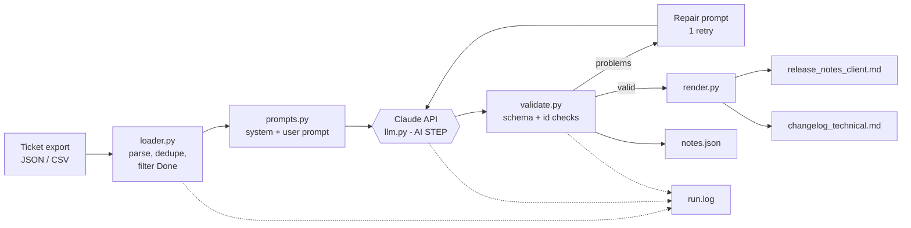

# Design

## 1. Problem definition
**Problem:** Release notes are written manually from engineer-oriented tickets. This is slow, inconsistent in tone,
easy to get wrong (missed breaking change, internal work leaked to client), and repeated every sprint.

**Use cases:** (1) sprint release notes, (2) hotfix from messy tickets, (3) migration release with breaking changes/known issues.

## 2. Architecture

**Data flow:** raw tickets -> cleaned tickets (code) -> prompt -> structured JSON (AI) -> validated JSON (code) -> two Markdown files (code).

**Where AI is used:** only the one step that needs language skill: classifying each ticket, rewriting it for two audiences,
writing the summary and flagging vague input. Everything deterministic is plain Python.

## 3. Key design decisions
| Decision | Why |
|---|---|
| One LLM call for all tickets | Summary and highlights need the whole release in view; ~10-50 tickets fit easily. |
| JSON output + validator | LLM output is untrusted. Checks catch hallucinated, missing or duplicated tickets. |
| One repair retry that shows the model its errors | Fixes most format slips cheaply, bounded cost, and fails loudly if still wrong. |
| `needs_attention` field | Gives the model a safe alternative to guessing; surfaces in "Needs Human Review". |
| Pre-filter in code (status, dedupe) | Cheaper and more reliable than asking the model to do it. |
| temperature 0.2 | Consistent structure, small wording variation. |
| Mock client | Lets reviewers run and test the full pipeline with no key. |

## 4. Prompt design
Techniques (all in `prompts.py`):
1. **Role/audience framing**: "senior technical writer... two audiences".
2. **Numbered rules**: especially *use only facts in tickets* and *exactly one entry per ticket*, aimed at hallucination and omission.
3. **Category definitions**: `breaking` vs `internal` vs `known_issue` are defined, because ticket types alone aren't enough.
4. **Length limits** (25 / 40 words) to keep client text tight.
5. **Strict JSON schema** + "JSON only", with a tolerant extractor as backup.
6. **One few-shot example** to anchor the business-vs-technical style contrast.
7. **Delimited data** (`<tickets>`) to separate data from instructions (reduces prompt injection from ticket text).
8. **Escape hatch** for vague tickets (rule 7) and mandatory action text for breaking changes (rule 8).
9. **Self-repair prompt** that lists the exact validation errors.

## 5. AI assistance in the design phase
See `AI_USAGE_LOG.md`.
